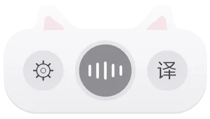
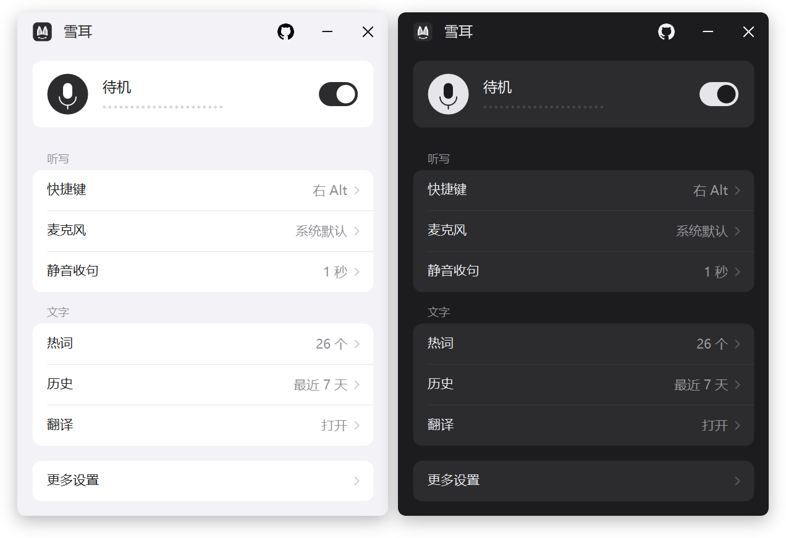

<div align="center">


# Xueer Ear (雪耳)

**Tap Right Alt, speak, and the words stream into the cursor as you talk.**

Chinese voice typing for Windows 11. It also works in terminal apps such as Claude Code and Codex.<br>
Recognition runs on Doubao Input Method's cloud service, with WeChat Input Method as an automatic backup: no model download, no sign-in, and the installer is about 4 MB.

[](https://github.com/hardware661/xueer-ear/releases/latest)
[](https://github.com/hardware661/xueer-ear/releases)
[](#install)
[](LICENSE)

[Download](https://github.com/hardware661/xueer-ear/releases/latest) · [中文说明](README.md) · [Changelog](CHANGELOG.md) · [Issues](https://github.com/hardware661/xueer-ear/issues)

<picture>
  <source media="(prefers-color-scheme: dark)" srcset="docs/images/panel-dark.webp">
  
</picture>

</div>

> [!NOTE]
> The interface is in Chinese, and recognition is tuned for Mandarin (English words mixed into Chinese sentences are fine). The rest of this page is a short English summary; [README.md](README.md) has the full manual.

## What it does

- Streaming dictation: text appears at the cursor while you are still talking. When you pause, the sentence is cleaned up (filler words, numbers, hotwords) and dictation keeps going.
- Works in terminals: one session can last 30 minutes. In the Claude Code and Codex prompt, voice commands can delete text and translate the whole prompt.
- No model download: recognition uses Doubao Input Method's cloud service with WeChat Input Method as the backup (or the other way round); a sentence the main service fails on is resent to the other one automatically. Nothing heavy runs on your PC, and you need neither app installed nor an account.
- Works next to a fan: steady background noise (fans, air conditioning) is filtered out before Xueer Ear decides where a sentence ends. In a noisy room it switches to WeChat as the main service, which recognized fan-noise speech better in our tests.
- Voice commands: pause, say "删除" (delete), "全部删除" (delete all) or "翻译成英文" (translate into English) on its own, pause again, and it runs. Each command has exactly one phrase and acts on the whole input box.
- Translation: Volcengine, Microsoft, Bilibili Index-Translate and WeChat Input Method, all free and keyless. Long text is split into pieces that are translated in parallel.
- Hotwords: add a term once and misheard product names get corrected. Fix a misheard word in the history list and Xueer Ear offers to remember the fix. A built-in list covers common AI and programming terms.
- Snippets: say a trigger phrase such as "我的邮箱" on its own and a saved text (your email address) is typed instead.
- Less fuss: other apps are turned down while you dictate; if no text field has focus, the round is copied to the clipboard instead of typed.
- Follows Windows: dark mode follows the system theme, and the installed version updates itself in one click (download, SHA-256 check, silent install, restart).

<p align="center">
  
</p>

## How it compares

| | Xueer Ear | Windows voice typing (Win+H) | [CapsWriter-Offline](https://github.com/HaujetZhao/CapsWriter-Offline) | [Handy](https://github.com/cjpais/Handy) |
| --- | --- | --- | --- | --- |
| Output | Streams while you talk | Streams while you talk | Whole result after you release the key | Whole result after you stop recording |
| Recognition | Doubao Input Method cloud (WeChat as fallback) | Microsoft cloud | Local offline model | Local offline model |
| Model download | No | No | Yes | Yes |
| Works offline | No | No | Yes | Yes |
| Hotwords | Yes | No | Yes | Yes |
| Platforms | Windows 11 | Windows 10, 11 | Windows 10, 11 | Windows, macOS, Linux |
| Open source | MIT | No | MIT | MIT |

The trade-off: Xueer Ear needs a network connection and sends your audio to Doubao Input Method's servers (or WeChat Input Method's, as a fallback) for recognition. In return you get streaming output with no local model. If you need offline recognition or want audio to stay on your machine, use CapsWriter-Offline or Handy.

In our tests, Win+H stops after about 30 seconds in a terminal. Xueer Ear does not go through Win+H, so it has no such limit.

## Install

You need Windows 11, a network connection and a microphone. Administrator rights are not required.

1. Download `xueer-ear-<version>-windows-x64-setup.exe` from the [releases page](https://github.com/hardware661/xueer-ear/releases/latest). A portable ZIP is also available.
2. Run the installer. It is not code-signed, so SmartScreen may say "Windows protected your PC"; click "More info", then "Run anyway". You can check the file against `SHA256SUMS.txt`.
3. On first launch the background service starts automatically.
4. Click into any text field, tap Right Alt and start talking. Tap it again, click the panel or press Esc to stop. Dictation also stops after 10 seconds without new text (adjustable under 更多设置).

The hotkey can be changed to Right Ctrl, CapsLock, F8 or F9 in the control panel. Holding the key counts as a tap; text waits until you release it (up to 3 seconds), because typing while Alt is held would trigger menu shortcuts.

## Voice commands

**Pause for 1 second, say the command on its own, then pause for 0.6 seconds.** Only then does Xueer Ear run it; the command word is never typed.

| Say | Effect | Default |
| --- | --- | --- |
| 删除 | Delete the last sentence in the input box: back to the previous 。？！ or line break, including trailing blanks | On |
| 全部删除 | Clear the whole input box | On |
| 发送 | Press Enter | Off |
| 翻译成英文 | Translate the whole input box into English and replace it | On |
| 翻译成中文 | Translate the whole input box into Chinese and replace it | On |

- One phrase per command. Matching ignores case and punctuation, not pronunciation.
- Without the pause before it, or said together with other words, a command is typed as plain text: "今天吃什么，发送" types exactly that. A command right after pressing the hotkey counts, since nothing came before it.
- Commands act on everything in the focused input box: what you typed, what Xueer Ear typed, earlier rounds.
- An empty box shows "输入框是空的"; no input box shows "没找到输入框", and nothing changes. Commands win over snippets.
- The switches and the two timings (pause before: 0.5/1/1.5/2 s; wait after: 0.3/0.6/1/1.5 s) are under 语音指令 in the control panel. The three dictation timings are under 更多设置.

How the input box is read:

| Where | How |
| --- | --- |
| Notepad, browser text fields | Windows UI Automation, no clipboard |
| WeChat and other apps UI Automation cannot read | Select all and copy, then restore your clipboard |
| Claude Code and Codex in Windows Terminal | Read the terminal screen and find the prompt lines |

Terminals with no recognizable prompt (a plain shell), code editors and web terminals are left alone with a short notice.

Voice translation refuses boxes over 2000 characters (use the translator window), replaces the box only if every piece translated and the box has not changed meanwhile, never ends dictation and never sends. In normal apps a multi-line result is pasted in one go, because a typed line break is Enter in WeChat and would send the message; your clipboard is restored as soon as the app has taken the text. In terminals, where Enter submits, the result is typed as one line.

## Translation services

The translator window and voice translation share the same services. Four are free and need no key: Volcengine (the API its browser extension uses), Microsoft (the API built into Edge), Bilibili Index-Translate (an official free API, small model) and WeChat Input Method. Microsoft Translator with your own key, Google Gemini and Zhipu come after them if configured.

- Text is split by paragraph and sentence into pieces of at most 600 characters, six in flight at a time.
- Each piece goes to the service that has recently been fastest. If it has not answered after 2 seconds plus 1 second per 300 characters (8 seconds at most), the next service gets the same piece and the first valid answer wins.
- One service gets at most 20 seconds per piece. A piece fails only when every service failed; there is no limit for the whole text.
- An empty answer, the wrong language, extra line breaks or a much shorter answer count as a failure and move on at once. A rate-limited service rests 5 minutes, a rejected key 6 hours.
- `%LOCALAPPDATA%\XueerEar\translate.log` gets one line per text (characters, pieces, pieces per service, hedges, time), never the content.

These free APIs are mostly internal to web pages and extensions and may change or throttle at any time; Xueer Ear moves on to the next service, and voice translation keeps the original if all fail.

## Noise, snippets and corrections

- Noise reduction: RNNoise cleans the audio only for deciding where you stopped talking; the cloud still receives the original audio, which it recognizes better. Without it, simulated fan noise kept the sentence open and WeChat lost 86% of the characters. On by default.
- Noisy rooms: with a real fan, Doubao got 14–17% of characters wrong and WeChat 7% (5–6% for both with the fan off), and denoised audio made both worse. So Xueer Ear measures how much louder your speech is than the background each round (about 8 times with the fan on, 256 with it off). Below 20 times, the next hotkey round uses WeChat as the main service; when the room is quiet again it goes back to your choice.
- Snippets: add them under 快捷短语 in the control panel, or edit `snippets.txt` (one `trigger=text` per line). The text is typed on one line: a `\n` becomes a space, since a line break is Enter in WeChat. Triggers match by pronunciation, only as a whole sentence, and cannot sound like a voice command.
- Corrections: click a sentence in 历史 (history). It is copied as before, and a small box lets you fix it. Xueer Ear compares the two versions and asks before adding a `wrong=right` rule to your hotword list, telling you how many past sentences the rule would change.

## Privacy

- Audio is streamed to the main recognition service (Doubao Input Method by default) while you dictate; a sentence it fails on is resent to the backup. Xueer Ear does not save recordings.
- When Doubao is used, the words in your hotword list (up to 100) are sent along as recognition hints. Recognition never sends the text in your input box or app names.
- When you say "翻译成英文" or "翻译成中文", the text in the input box is sent to the translation services: Volcengine, Microsoft, Bilibili and WeChat Input Method, plus Microsoft Translator, Google or Zhipu only if you add a key. A piece that is slow to come back is also sent to the next service. The translator window works the same way.
- Reading the input box: in apps such as WeChat, Xueer Ear selects all and copies, then restores your clipboard. Terminal screen text is read locally and only the prompt lines are used.
- No account: a random anonymous device identity for each service is created on first use and kept on your PC.
- Settings, hotwords, snippets, history and logs live in `%LOCALAPPDATA%\XueerEar`. Apart from recognition and translation, the app only contacts GitHub anonymously to check for and download updates.

## Integration: dictation status

Xueer Ear writes `%LOCALAPPDATA%\XueerEar\status.json` at least every 5 seconds while the service runs. Other programs can read `dictating` (true during a dictation round) and `updated_ms` (Unix milliseconds; treat more than 15 seconds old as "not dictating") to stay quiet while you talk. [Xueer Speaker](https://github.com/hardware661/xueer-speaker) uses it to hold announcements until you finish.

## Build

A full build needs Windows with the Rust MSVC toolchain, Visual Studio C++ build tools, the Windows SDK and CMake; the installer also needs Inno Setup 6.

```powershell
cargo test --workspace
./packaging/build-windows.ps1   # PowerShell 7: builds the portable ZIP and the installer
```

See [CONTRIBUTING.md](CONTRIBUTING.md) before sending a pull request.

## Credits

- [weiwin](https://github.com/Elnyxn/weiwin) (Elnyxn, MIT): Xueer Ear is built on it; the WeChat Input Method cloud recognition client comes from weiwin.
- [CapsWriter-Offline](https://github.com/HaujetZhao/CapsWriter-Offline) (Haujet Zhao, MIT): part of the built-in hotword list follows its examples.
- [VoiceKey](https://github.com/J3n5en/voicekey) (J3n5en, Apache-2.0), [doubao-asr-free](https://github.com/RayMorTwinkle/doubao-asr-free) (RayMorTwinkle), [doubao-asr-web](https://github.com/glwhappen/doubao-asr-web) (glwhappen, MIT) and [VoxType](https://github.com/melody0709/VoxType) (melody0709): their public notes on the Doubao Input Method protocol were the reference for Xueer Ear's own client.
- [nnnoiseless](https://github.com/jneem/nnnoiseless) (Joe Neeman, BSD-3-Clause): the Rust port of RNNoise used for noise reduction. Its license ships as `RNNOISE-LICENSE.txt`.
- [FluentRead](https://github.com/FluentRead/FluentRead) and [kiss-translator](https://github.com/fishjar/kiss-translator): their public notes on the free Volcengine and Microsoft APIs and on hedged scheduling were the reference; the code is Xueer Ear's own. [Bilibili Index-Translate](https://github.com/bilibili/Index-Translate) (Apache-2.0) provides the official free translation API.

## License

[MIT](LICENSE)
