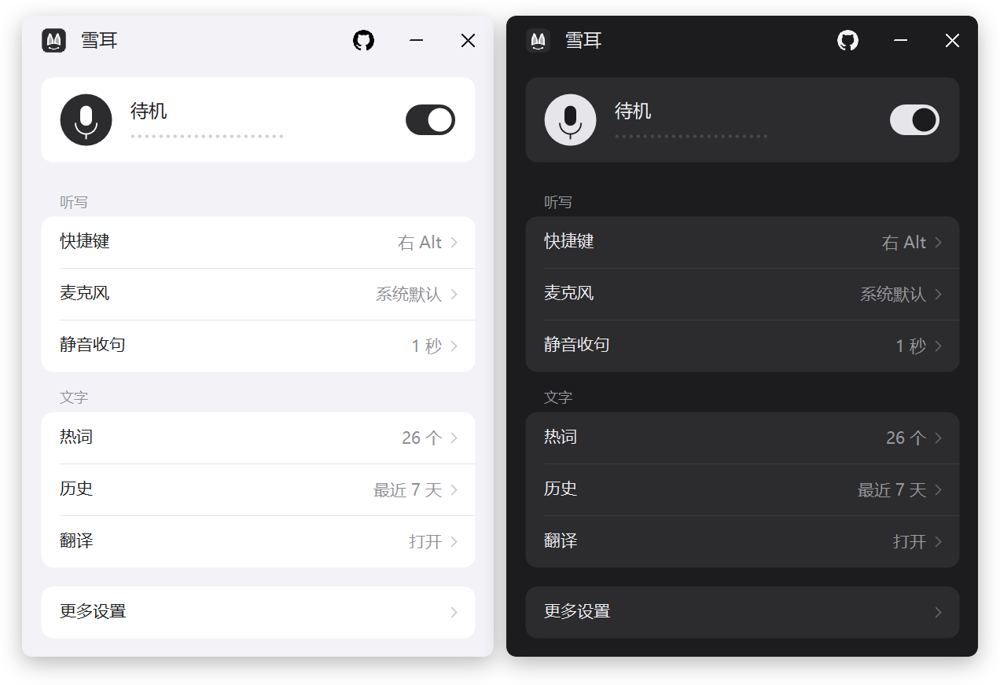

<div align="center">


# 雪耳

**点一下右 Alt，说话，字边说边打到光标那里。**

Windows 11 的中文语音输入。Claude Code、Codex 这类终端程序里也能用。<br>
用豆包输入法的云端识别，微信输入法自动备用：不用下载模型，不用登录，安装包 4 MB 左右。

[](https://github.com/hardware661/xueer-ear/releases/latest)
[](https://github.com/hardware661/xueer-ear/releases)
[](#下载和安装)
[](LICENSE)

[下载](https://github.com/hardware661/xueer-ear/releases/latest) · [English](README.en.md) · [更新记录](CHANGELOG.md) · [提问题](https://github.com/hardware661/xueer-ear/issues)

<picture>
  <source media="(prefers-color-scheme: dark)" srcset="docs/images/panel-dark.webp">
  
</picture>

</div>

## 雪耳能做什么

- 边说边出字：话没说完，字已经打到光标处。停顿时整理这一句（去口头禅、转数字、改热词），然后接着听。
- 终端里也能用：一次最长听 30 分钟。Claude Code、Codex 的输入框里也能用语音指令删字、整框翻译。
- 不用下载模型：识别走豆包输入法的云端，微信输入法做备用（也可以反过来，微信为主、豆包备用），连不上的那句自动换另一家。不占本机算力，不用装豆包和微信，也不用登录。
- 开风扇也能用：断句前先滤掉风扇、空调这种一直响的底噪，一句话照常收尾；屋里吵时自动改用微信为主，开风扇时它认得更准。
- 语音指令：先停一下，单独说「删除」「全部删除」「翻译成英文」，再停一下就执行。一个指令只有一个说法，管整个输入框。
- 整框翻译：说「翻译成英文」，整个输入框换成英文，你手打的、上一轮说的都算。翻译走火山、微软、B 站和微信输入法这几家免费服务，长文切段同时翻。
- 热词：专有名词老是听错，加一条就改对。在历史里把听错的字改过来，雪耳问一句就记成热词。自带一份 AI 和编程里常听错的词。
- 快捷短语：整句说「我的邮箱」，打出事先写好的邮箱地址。
- 少操心：听写时别的程序自动小声，说完恢复；没有输入框时，说的话自动复制。
- 跟随系统：深色模式跟着 Windows 走；有新版本时，点一下就下载、核对、装好、重开。

<p align="center">
  
</p>

## 和其他语音输入比

| | 雪耳 | Windows 语音输入（Win+H） | [CapsWriter-Offline](https://github.com/HaujetZhao/CapsWriter-Offline) | [Handy](https://github.com/cjpais/Handy) |
| --- | --- | --- | --- | --- |
| 出字方式 | 边说边出字 | 边说边出字 | 松开按键后整段上屏 | 停止录音后整段粘贴 |
| 识别在哪 | 豆包输入法云端（备用微信输入法） | 微软云端 | 本机离线模型 | 本机离线模型 |
| 要下载模型 | 不用 | 不用 | 要 | 要 |
| 断网能用 | 不能 | 不能 | 能 | 能 |
| 热词 | 有 | 没有 | 有 | 有 |
| 系统 | Windows 11 | Windows 10、11 | Windows 10、11 | Windows、macOS、Linux |
| 开源 | MIT | 否 | MIT | MIT |

雪耳的取舍是：要联网，声音要发到豆包输入法（备用微信输入法）的服务器识别；换来边说边出字、不占本机算力、装好就能用。看重断网可用、声音不出本机，选 CapsWriter-Offline 或 Handy。

微软的 Win+H 在终端里听写，我们实测约 30 秒就停，还会提示「某些语音键入功能可能不起作用」。雪耳不经过 Win+H，没有这个限制。

## 下载和安装

需要 Windows 11、能上网、有个麦克风，不需要管理员权限。

1. 到[发布页](https://github.com/hardware661/xueer-ear/releases/latest)下载安装版 `xueer-ear-<版本>-windows-x64-setup.exe`。
2. 运行安装包。安装包没有代码签名，Windows 可能弹出「Windows 已保护你的电脑」，点「更多信息」，再点「仍要运行」。
3. 第一次打开会自动开好后台服务，状态那里写着「点一下右 Alt 说话试试」。
4. 在要打字的地方点一下右 Alt，开始说话。

| 文件 | 用法 |
| --- | --- |
| `xueer-ear-<版本>-windows-x64-setup.exe` | 安装版：装到当前用户目录，可选开机自启，能一键更新 |
| `xueer-ear-<版本>-windows-x64-portable.zip` | 便携版：解压后运行 `xueer-ear.exe` |
| `SHA256SUMS.txt` | 两个文件的 SHA-256 校验值 |

控制面板的「后台服务」开关决定雪耳工不工作，关掉后快捷键就不响应了。托盘「退出」会先停后台服务，再退出程序；接管过 Win+H 的话，会先把它还给系统。

### 更新

启动时检查一次，之后每 6 小时检查一次。有新版本时，控制面板右上角的 GitHub 图标上会出现小圆点，弹出提示：

- 安装版点「下载更新」：后台下载安装包，核对 SHA-256，静默装好后自己重新打开，后台服务照常开着。
- 便携版点「下载更新」：打开发布页，自己下载替换。

下载失败（比如连不上 GitHub）会写明原因，并打开发布页。

## 怎么用

### 快捷键听写

默认快捷键是右 Alt。在控制面板「快捷键」一行可以换成右 Ctrl、CapsLock、F8 或 F9，换完马上生效（正在听写时换的，这次结束后生效）。

| 操作 | 效果 |
| --- | --- |
| 点一下右 Alt | 屏幕顶部中间出现小猫面板，开始听。面板中间是麦克风，左边齿轮打开控制面板，右边「译」打开翻译小窗 |
| 说话 | 字边说边出现在光标处，麦克风变成跟着声音跳的波浪。说话途中只往后接字，云端改了前面的字，等这句说定时一次改好 |
| 停顿 | 这句话说定，过一遍文字整理（去口头禅、数字、热词）。听写不会停，接着说就接着写。话停在「然后我的」这种没说完的地方，不补句号，下一句直接接上 |
| 再点一下右 Alt、点面板或按 Esc | 结束听写，面板消失 |
| 10 秒没识别出新的字 | 自动结束（在「更多设置」里可以改） |
| 说到一半，你自己打了字或点了鼠标 | 这一句不再回头改前面的字，只往后接着写 |

按住右 Alt 不放也算点一下，松开不会结束。按着 Alt 打字会变成程序的菜单快捷键，所以字要等你松开右 Alt 才打出来（最多等 3 秒）。

一次最长听 30 分钟，可以在「更多设置」里改成 10、60 或 120 分钟。

### 识别通道

豆包和微信互为备用，选哪家哪家为主，默认豆包为主。主通道连不上、出错或者中途断了，这一句已经录的音自动改发给备用的那家，面板提示一行，不用重说。主通道 1.5 秒还没连上，就同时连备用，谁先连上用谁。一轮听写里主通道连着失败 3 次，剩下的话都走备用，下一轮再试主通道。

想让微信为主：在「更多设置」最上面选「微信为主，豆包备用」。

按下快捷键时雪耳就在后台先把主通道连好，每说完一句又先连好下一句，开口时不用再等连接。每轮开头各步用了多久（开麦、连上、出第一个字）只记毫秒数，写在 `service.log` 里，反应慢时可以看。

### 降噪

开着风扇、空调时，一直响的底噪会让雪耳以为你一直在说话，一句话迟迟不收尾。雪耳断句前先用 RNNoise 滤掉这种底噪，判断你说完没有；发给云端的仍是原声，云端对原声认得更准。

我们用模拟的风扇声测过 8 句话。不降噪时 8 句话被当成一句，微信那边错了 86%；降噪后断句正常。降噪默认开，在「更多设置」里可以关。

我们也用真的风扇录过同样 8 句话。关风扇时豆包错字 6%、微信 5%；开风扇时豆包错 14%～17%，微信只错 7%。降噪后的声音再发给云端，两家都错得更多，所以不加「强降噪」，改成屋里吵时换主通道：

- 雪耳每轮听写都比一比说话比底噪响多少倍。实测开风扇约 8 倍，关风扇约 256 倍。
- 上一轮不到 20 倍就算吵，这一轮快捷键听写改成微信为主、豆包备用；安静了回到你选的那家。
- `service.log` 里每轮记一行「这轮说话比底噪响 N 倍」，算吵时后面写「（算吵）」。

### 语音指令

**先停 1 秒，单独说指令，再停 0.6 秒，雪耳才执行。** 指令词不会打到屏幕上。

| 说 | 效果 | 默认 |
| --- | --- | --- |
| 删除 | 删掉输入框里最后一句：从末尾往前删到上一个句号、问号、感叹号或换行，末尾的空白一起删 | 开 |
| 全部删除 | 清空整个输入框 | 开 |
| 发送 | 按回车 | 关 |
| 翻译成英文 | 整个输入框翻成英文，换掉原文 | 开 |
| 翻译成中文 | 整个输入框翻成中文，换掉原文 | 开 |

规则是固定的：

- 一个指令只有一个说法。比对时不分大小写、不管标点，不按读音猜。
- 前面没停够，或者跟别的字连着说，一律当普通字打出来。一口气说「今天吃什么，发送」，打出来的就是这几个字。刚按下快捷键就说指令也算，前面没有别的话。
- 指令管光标所在输入框里的全部文字：你手打的、雪耳打的、上一轮说的都算，切过窗口、动过键盘鼠标也一样。
- 框是空的，面板提示「输入框是空的」；找不到输入框，提示「没找到输入框」，什么都不动。
- 指令比快捷短语优先。

雪耳这样读整个输入框：

| 在哪 | 怎么读 |
| --- | --- |
| 记事本、浏览器里的输入框 | 用 Windows 的 UI 自动化直接读，不碰剪贴板 |
| 微信，和其他直接读不到的程序 | 全选、复制来读，读完把剪贴板还原 |
| Windows Terminal 里的 Claude Code、Codex | 读终端屏幕上的字，认出输入框那几行 |

- 认不出输入框的终端（比如普通命令行）、代码编辑器和网页里的终端，雪耳不动，面板提示一句。
- 终端里没有全选：删除是把光标挪到最后，按字数退格。
- 读微信要经过剪贴板。开着 Win+V 剪贴板历史的话，那里会多一条框里的字。

### 改开关和时间

控制面板「语音指令」一行：5 个指令各一个开关，再加两个时间。

| 时间 | 默认 | 还可以选 |
| --- | --- | --- |
| 指令前停多久 | 1 秒 | 0.5、1.5、2 秒 |
| 说完指令后等多久执行 | 0.6 秒 | 0.3、1、1.5 秒 |

听写的三个时间在「更多设置」里：

| 时间 | 默认 | 还可以选 |
| --- | --- | --- |
| 停多久算一句说完 | 3 秒 | 1、2、5、10 秒 |
| 多久没有新字自动结束 | 10 秒 | 5、20、30、60 秒 |
| 一次最长听多久 | 30 分钟 | 10、60、120 分钟 |

改完从下一句开始生效。

### 语音翻译

说「翻译成英文」或「翻译成中文」，整个输入框翻好后换掉原文。

- 输入框里超过 2000 字不翻，面板提示改用翻译小窗。
- 长的会切成几段翻，每一段都翻成才替换；有一段没翻成就不动，面板提示原因。
- 译文回来时输入框已经变了（你又打了字），不替换。
- 普通程序里，多行的译文整段粘贴：一个字一个字打的话，换行在微信里就是回车，会把消息发出去。粘贴前存下你的剪贴板，那个程序把字取走后马上还原。
- 终端里回车就是提交，译文并成一行打。
- 翻译不会结束听写，也不会自动发送，可以接着说「发送」。

### 翻译小窗

点面板右边的「译」，或者控制面板「翻译 → 打开翻译小窗」，会弹出翻译小窗。

<picture>
  <source media="(prefers-color-scheme: dark)" srcset="docs/images/translate-dark.png">
  
</picture>

上面输入或粘贴，下面出译文。中间「中 ⇄ 英」点一下反转方向。边打字边自动翻，间隔从 1 秒起，翻得越多间隔越长（2、4、8 秒）；点「翻译」或按回车立刻翻（Shift+回车换行）。点右下角的图标复制译文，Ctrl+A 全选。窗口可以拖边改大小、最大化，Esc 关闭。

长文章也能翻：雪耳把它切成段，同时发出去，1 万字几秒钟翻完。有的段没翻成，那一段留着原文，底栏提示有几段没翻成。

### 翻译服务

语音翻译和翻译小窗用同一套服务。下面四家都免费，不用 Key，也不用登录：

| 服务 | 说明 |
| --- | --- |
| 火山翻译 | 火山翻译浏览器插件用的接口 |
| 微软翻译 | Edge 浏览器自带翻译用的接口 |
| B 站 Index-Translate | B 站官方公开的免费接口，小模型 |
| 微信输入法 | 微信输入法的云端翻译 |

配了 Key 的微软翻译正式版、谷歌 Gemini 和智谱排在这四家后面。

雪耳这样分活：

- 长文按段落和句子切成段，每段最多 600 字，同时翻 6 段。
- 每段先交给最近又快又稳的那家。短段等 2 秒，每多 300 字多等 1 秒，最多 8 秒；到时间还没回来，就让下一家也翻这一段，谁先回来用谁。
- 一家最多等 20 秒。一段要所有家都没翻成才算失败，整篇不设总时限。
- 译文是空的、方向不对、比原文多出换行或者明显少了一截，都算这家没翻成，马上换下一家。
- 被限流的那家歇 5 分钟，Key 不对的歇 6 小时，连着失败 3 次的歇 1 分钟。
- 先后按你电脑上最近的实测自动排。没测过时按火山、微软、B 站、微信的顺序。

每翻一篇，`%LOCALAPPDATA%\XueerEar\translate.log` 记一行：多少字、几段、各家翻了几段、补位几次、用了多久，不记内容。

在控制面板点「翻译 → 打开翻译设置」，会打开本机的 `%LOCALAPPDATA%\XueerEar\translate.json`。把 `wetype_enabled` 改成 `false` 可以不用微信翻译，不影响听写。没有 Key 的服务留空：

```json
{"wetype_enabled": true, "azure_key": "", "azure_region": "eastasia", "google_key": "", "zhipu_key": ""}
```

这几家免费接口多是网页、插件内部用的，随时可能改或限流。雪耳会自动换别家，全都不行时语音翻译保留原文。

### 文字整理

每句说定时整理一遍：

| 功能 | 例子 | 默认 |
| --- | --- | --- |
| 去口头禅 | 「嗯，今天提交」→「今天提交」；「那个文件」不动 | 开 |
| 中文数字转阿拉伯数字 | 「百分之五十」→「50%」、「三点五」→「3.5」；「一下」「千万别」不动 | 开 |
| 热词纠错 | 热词表里写「雪耳」，识别成「雪而」会改回来；英文大小写也会改对 | 开（热词表要自己填） |
| 去掉末尾句号 / 中英文之间加空格 / 中文旁用全角标点 | — | 关 |

这些开关都在控制面板「更多设置」里，从下一次听写开始生效。「更多设置」最上面是识别通道：豆包为主，或者微信为主。

### 热词

专有名词老是听错，就加进热词表。在控制面板点「热词 → 添加热词」，填两格：

| 填什么 | 效果 |
| --- | --- |
| 只填「正确的写法」，例如 `雪耳` | 识别结果里读音相同的字（雪而、雪儿）改成这个词 |
| 两格都填，例如正确的写法 `Claude Code`、常被听成 `Cloud Code` | 识别结果里出现 Cloud Code 就换成 Claude Code |

第二种用来对付读音对不上的错法。英文不分大小写，只换整个词：把 `out` 换成 `Alt`，不会动到 `output`。

「热词 → 打开热词表」用记事本打开整张表，一行一个词，替换规则写成 `错=对`。改完从下一次听写开始生效。

加之前想一想：读音一样的两个词（比如「雪儿」和「雪耳」）只能留一个，不然另一个会被改掉；大小写本来就对的词（Alt、bug）不用加，加了反而会改动原话。

软件自带一份 AI、编程里常听错的词，比如「克劳德」→ Claude、「Cloud Code」→ Claude Code、「欧拉玛」→ Ollama、「温加H」→ Win+H。每条都写明了错法，不按读音乱改。默认开着，在「热词」菜单里可以关掉。你自己的热词表和它冲突时，用你写的。

改热词之前可以先试一下：命令行跑 `xueer-ear-cli hotword-check`，会拿本机的听写历史按现在的热词过一遍，列出会被改动的句子。只读本机文件，不上传。

走豆包时，热词表里的词（最多 100 个）会作为识别提示一起发过去。我们实测「Resin」带提示 4 次全认对，不带全认错；最后仍以本机的热词纠错为准。

### 在历史里改错

在控制面板「历史」里点一句，除了复制，还会弹出「改一下这句」。把听错的字改过来，点「记住改法」，雪耳比对改前改后，问一句「以后把「雪而」改成「雪耳」？」，同时说历史里有几句会跟着这样改。同意才写进热词表。

只改了一个字时，规则会带上旁边一个字（写成 `雪而=雪耳`），免得把所有的「而」都改成「耳」。只改标点、大小写，或者只是加字、删字，不算听错，不会记。只想复制的话，弹出来时按 Esc。

### 快捷短语

整句只说一个口令，就打出事先写好的一段文字。比如口令「我的邮箱」，文字是邮箱地址。

在控制面板点「快捷短语 → 添加快捷短语」，填口令和文字。菜单里点一条可以删掉；「打开快捷短语表」用记事本打开 `snippets.txt`，一行一条 `口令=文字`。

- 口令按读音认：识别成「我的油箱」也算。
- 只认整句：「把我的邮箱发给他」照常打字。
- 和 5 个语音指令读音一样的口令加不进去。
- 换出来的文字原样打出，不改数字和标点。文字写成一行；以前写的 `\n` 打出来是空格，因为换行在微信里就是回车，会把消息发出去。

### 出错时

| 情况 | 雪耳怎么做 |
| --- | --- |
| 说到一半网络断了一下 | 自动重连，把这一句已经录的音重发一遍，你不用重说 |
| 重连还是不行 | 面板变宽，写一句原因（例如「网络不通，这句没识别出来」），4 秒后自己收起，点一下马上收起 |
| 麦克风打不开 | 面板提示「麦克风打不开，请检查设备」 |

出错时屏幕上已经打出来的字不会被删。还没说定的那一截存进历史，可以从「历史」里找回来。

### 其他

| 功能 | 说明 |
| --- | --- |
| 历史记录 | 本机保存最近 7 天说过的话。控制面板点「历史」列出最近 10 句，点一句就复制，还能改错（见「热词」）；「打开全部记录」用记事本打开。记不记、保留几天（1、7、30、90 天）也在「历史」菜单里 |
| 听写时调小别的声音 | 听写时把正在出声的程序（音乐、视频、游戏）调到原来的 20%，这一轮说完恢复。只动音量合成器里各程序自己的音量，不暂停，也不动系统总音量。默认开，在「更多设置」里可以关 |
| 没有输入框时 | 点右 Alt 时焦点在桌面、文件列表、按钮上，或者在没点进输入框的网页上：这一轮不往屏幕上打字（免得字母被当成快捷键），说完把文字复制到剪贴板，面板提示「没找到输入框，已复制，Ctrl+V 粘贴」。中途点进了输入框，后面的话照常打字。拿不准的窗口都照常打字 |
| 提示音 | 整次听写一个字都没识别出来时，晓晓说「这次没听清」；可关 |
| 开机自启 | 安装时勾上，登录后在托盘待命 |
| 管理员权限的窗口 | 雪耳默认以普通权限运行。要往管理员权限的窗口里打字，在「更多设置」里打开「以管理员身份运行」，之后每次启动会弹一次 UAC 确认 |
| 接管 Win+H | 默认关，在「更多设置」里打开。打开后 Win+H 的识别也换成雪耳（面板仍是微软的，终端里仍有 30 秒限制）。切换时后台服务会自动重启一次 |
| 复制诊断信息 | 「更多设置 → 复制诊断信息」：复制版本、系统版本、几项设置和日志最后 50 行。日志只记字数和错误原因，不记说过的话；用户目录会换成 `%USERPROFILE%` 这样的变量名 |

> [!IMPORTANT]
> 「同时接管 Win+H」打开后，程序启动时会核对几个系统组件的指纹。只有已经适配过的 Windows 版本才会接管；对不上就不接管，快捷键听写和系统原来的语音输入都照常能用。

## 隐私

- 声音：听写时，录音实时发到主通道（默认豆包输入法）的云端识别；主通道连不上的那句改发备用的那家。雪耳不保存录音。
- 热词：走豆包时，热词表里的词作为识别提示一起发过去。识别时不发输入框里的字和程序名。
- 翻译：说「翻译成英文 / 中文」时，整个输入框里的字发给翻译服务：火山、微软、B 站和微信输入法，配了 Key 才会用微软正式版、谷歌或智谱。一段翻得慢时，这一段会再发给下一家。翻译小窗里的字也一样。
- 读输入框：微信这类读不到的程序，雪耳全选、复制来读，读完还原剪贴板；终端屏幕上的字只在本机读，只用输入框那几行。
- 身份：不用登录。第一次用到豆包、微信时各随机生成一个匿名设备身份，只存在本机。
- 本机数据：设置、热词、快捷短语、历史记录和日志都在 `%LOCALAPPDATA%\XueerEar`，升级和卸载都不会删。
- 联网：除了识别和翻译，雪耳只会匿名访问 GitHub 检查和下载更新，不收集使用数据。

发布包里只有程序和桥接 DLL，不含设备身份、凭据、录音或日志。

## 常见问题

**杀毒软件报毒怎么办？**
「接管 Win+H」要把一个 DLL 加载进系统的语音输入进程，这种写法容易被杀毒软件当成可疑行为。不放心的话，用 `SHA256SUMS.txt` 核对下载的文件和发布页一致，或者看源码自己构建。

**往某个窗口里说话没反应？**
那个窗口多半是以管理员身份运行的。在「更多设置」里打开「以管理员身份运行」。

**提问题时要附什么？**
在「更多设置」里点「复制诊断信息」，贴到 [issue](https://github.com/hardware661/xueer-ear/issues/new/choose) 里，再写清在哪个程序里、怎么操作时出的问题。

## 给别的程序用：听写状态

雪耳把状态写在 `%LOCALAPPDATA%\XueerEar\status.json`，后台服务活着时至少每 5 秒更新一次。别的程序可以读它，避开你正在说话的时候，比如先不播报：

| 字段 | 意思 |
| --- | --- |
| `dictating` | `true` 表示正在一轮听写里，从开始听到这一轮收尾 |
| `phase` | 后台现在的状态，例如 `ready`、`armed`、`recognizing`、`error` |
| `updated_ms` | 最后一次写入的时间（Unix 毫秒） |

读的时候不要锁文件。`updated_ms` 超过 15 秒没变，说明后台没在跑，按「没在听写」处理。

[雪儿 speaker](https://github.com/hardware661/xueer-speaker#和雪耳一起用你说话时先不出声) 就是这样用的：你用雪耳说话时，它先不出声，这一轮结束再按顺序念。

## 开发

先读 [AGENTS.md](AGENTS.md)、[STATE.md](STATE.md) 和 [CONTRIBUTING.md](CONTRIBUTING.md)。

```bash
# 不依赖 Windows 的部分（文字整理、历史记录、各种状态和菜单逻辑）在 WSL 或 Linux 里就能测
cargo test -p xueer-ear-textflow -p xueer-ear-history -p xueer-ear-audio -p xueer-ear-backend -p xueer-ear-host -p xueer-ear
```

完整构建需要 Windows：Rust（MSVC 工具链）、Visual Studio C++ 构建工具、Windows SDK 和 CMake；出安装包还要 Inno Setup 6。

```powershell
cargo test --workspace
./packaging/build-windows.ps1   # PowerShell 7：生成便携版和安装版
```

工具要求和安装包的约定见 [packaging/README.md](packaging/README.md)。README 里的配图都是离屏渲染的，重新生成用 `tools/readme-images.sh`。

## 致谢

- [微win](https://github.com/Elnyxn/weiwin)（Elnyxn，MIT）：雪耳在它的基础上开发，接入微信输入法云端识别的部分来自微win。
- [CapsWriter-Offline](https://github.com/HaujetZhao/CapsWriter-Offline)（Haujet Zhao，MIT）：自带热词表里的部分错法对照参考了它的热词示例。
- [VoiceKey](https://github.com/J3n5en/voicekey)（J3n5en，Apache-2.0）、[doubao-asr-free](https://github.com/RayMorTwinkle/doubao-asr-free)（RayMorTwinkle）、[doubao-asr-web](https://github.com/glwhappen/doubao-asr-web)（glwhappen，MIT）和 [VoxType](https://github.com/melody0709/VoxType)（melody0709）：接入豆包输入法云端识别时参考了它们公开的协议资料，代码是雪耳自己写的。
- [nnnoiseless](https://github.com/jneem/nnnoiseless)（Joe Neeman，BSD-3-Clause）：RNNoise 的 Rust 移植，雪耳用它给断句降噪。许可原文在安装目录的 `RNNOISE-LICENSE.txt`。
- [FluentRead](https://github.com/FluentRead/FluentRead) 和 [简约翻译](https://github.com/fishjar/kiss-translator)：接入火山、微软免费翻译时参考了它们公开的接口资料和调度思路，代码是雪耳自己写的。[B 站 Index-Translate](https://github.com/bilibili/Index-Translate)（Apache-2.0）提供官方免费的翻译接口。

## 许可

[MIT](LICENSE)
