<div align="center">


# 雪耳

**点一下右 Alt，说话，字边说边打到光标那里。**

Windows 11 的中文语音输入。Claude Code、Codex 这类终端程序里也能用。<br>
用微信输入法的云端识别：不用下载模型，不用登录，安装包不到 4 MB。

[](https://github.com/hardware661/xueer-ear/releases/latest)
[](https://github.com/hardware661/xueer-ear/releases)
[](#下载和安装)
[](LICENSE)

[下载](https://github.com/hardware661/xueer-ear/releases/latest) · [English](README.en.md) · [更新记录](CHANGELOG.md) · [提问题](https://github.com/hardware661/xueer-ear/issues)

<picture>
  <source media="(prefers-color-scheme: dark)" srcset="docs/images/panel-dark.png">
  
</picture>

</div>

## 雪耳能做什么

- 边说边出字：话没说完，字已经打到光标处。停顿时整理这一句（去口头禅、转数字、改热词），然后接着听。
- 终端里也能用：一次最长听 30 分钟。说「换行」在 Claude Code 里只换行、不发送，说「发送」才按回车。
- 不用下载模型：识别和翻译走微信输入法的云端服务，不占本机算力。不用装微信，也不用登录。
- 语音指令：「删掉上一句」「全部删除」「翻译成英文」，说完停一下就执行。
- 热词：专有名词老是听错，加一条就改对。自带一份 AI 和编程里常听错的词。
- 跟随系统：深色模式跟着 Windows 走；有新版本时，点一下就下载、核对、装好、重开。

<p align="center">
  
</p>

## 和其他语音输入比

| | 雪耳 | Windows 语音输入（Win+H） | [CapsWriter-Offline](https://github.com/HaujetZhao/CapsWriter-Offline) | [Handy](https://github.com/cjpais/Handy) |
| --- | --- | --- | --- | --- |
| 出字方式 | 边说边出字 | 边说边出字 | 松开按键后整段上屏 | 停止录音后整段粘贴 |
| 识别在哪 | 微信输入法云端 | 微软云端 | 本机离线模型 | 本机离线模型 |
| 要下载模型 | 不用 | 不用 | 要 | 要 |
| 断网能用 | 不能 | 不能 | 能 | 能 |
| 热词 | 有 | 没有 | 有 | 有 |
| 系统 | Windows 11 | Windows 10、11 | Windows 10、11 | Windows、macOS、Linux |
| 开源 | MIT | 否 | MIT | MIT |

雪耳的取舍是：要联网，声音要发到微信输入法的服务器识别；换来边说边出字、不占本机算力、装好就能用。看重断网可用、声音不出本机，选 CapsWriter-Offline 或 Handy。

微软的 Win+H 在终端里听写，我们实测约 30 秒就停，还会提示「某些语音键入功能可能不起作用」。雪耳不经过 Win+H，没有这个限制。

## 下载和安装

需要 Windows 11、能上网、有个麦克风，不需要管理员权限。

1. 到[发布页](https://github.com/hardware661/xueer-ear/releases/latest)下载安装版 `xueer-ear-<版本>-windows-x64-setup.exe`。
2. 运行安装包。安装包没有代码签名，Windows 可能弹出「Windows 已保护你的电脑」，点「更多信息」，再点「仍要运行」。
3. 第一次打开会自动开好后台服务，状态那里写着「点一下右 Alt 说话试试」。
4. 在要打字的地方点一下右 Alt，开始说话。

| 文件 | 用法 |
| --- | --- |
| `xueer-ear-<版本>-windows-x64-setup.exe` | 安装版：装到当前用户目录，可选开机自启，能一键更新 |
| `xueer-ear-<版本>-windows-x64-portable.zip` | 便携版：解压后运行 `xueer-ear.exe` |
| `SHA256SUMS.txt` | 两个文件的 SHA-256 校验值 |

控制面板的「后台服务」开关决定雪耳工不工作，关掉后快捷键就不响应了。托盘「退出」会先停后台服务，再退出程序；接管过 Win+H 的话，会先把它还给系统。

### 更新

启动时检查一次，之后每 6 小时检查一次。有新版本时，控制面板右上角的 GitHub 图标上会出现小圆点，弹出提示：

- 安装版点「下载更新」：后台下载安装包，核对 SHA-256，静默装好后自己重新打开，后台服务照常开着。
- 便携版点「下载更新」：打开发布页，自己下载替换。

下载失败（比如连不上 GitHub）会写明原因，并打开发布页。

## 怎么用

### 快捷键听写

默认快捷键是右 Alt。在控制面板「快捷键」一行可以换成右 Ctrl、CapsLock、F8 或 F9，换完马上生效（正在听写时换的，这次结束后生效）。

| 操作 | 效果 |
| --- | --- |
| 点一下右 Alt | 屏幕顶部中间出现小猫面板，开始听。面板中间是麦克风，左边齿轮打开控制面板，右边「译」打开翻译小窗 |
| 说话 | 字边说边出现在光标处，麦克风变成跟着声音跳的波浪。说话途中只往后接字，云端改了前面的字，等这句说定时一次改好 |
| 停顿 | 这句话说定，过一遍文字整理（去口头禅、数字、热词）。听写不会停，接着说就接着写。话停在「然后我的」这种没说完的地方，不补句号，下一句直接接上 |
| 再点一下右 Alt、点面板或按 Esc | 结束听写，面板消失 |
| 按住右 Alt 说、松开 | 松开就结束 |
| 10 秒没识别出新的字 | 自动结束 |
| 说到一半，你自己打了字或点了鼠标 | 这一句不再回头改前面的字，只往后接着写；删除类的语音指令这一句不执行 |

一次最长听 30 分钟，可以在「更多设置」里改成 10、60 或 120 分钟。

### 语音指令

单独说一句指令词（前后停顿一下）就会执行，不会打出这几个字。「换行」「发送」「删掉上一句」「翻译」也可以接在一句话最后说，比如「这句不对，删掉上一句」。「删除」「清空」这类短词只在单独说时才算，免得「这些临时文件，全部删除」这种正常说话被当成指令。说完停一下就执行：

| 说 | 效果 |
| --- | --- |
| 换行 | 换一行。终端里发 Ctrl+J：在 Claude Code 这类程序里是换行，不会把消息发出去 |
| 删除（也可以说：删掉、撤销、撤回、删掉上一句、删除上一句话、删掉上一行） | 删掉雪耳刚打出来的上一句；上一句在上一行时，连换行一起删回去 |
| 全部删除（也可以说：全部删掉、全都删除、全删了、清空） | 删掉这次听写里雪耳打的全部内容 |
| 发送 | 按回车。默认关着，要在「更多设置」里打开 |
| 翻译成英文 | 把这一轮雪耳打出来的字整段换成英文，已经是英文的部分不动 |
| 翻译成中文 | 整段换成中文，已经是中文的部分不动 |
| 翻译 | 有中文就整段翻成英文；全是英文就翻成中文 |

> [!WARNING]
> 在普通 bash/zsh 命令行里，Ctrl+J 等于回车，说「换行」会执行命令。常在普通命令行里听写的话，在「更多设置」里关掉「终端里说「换行」发 Ctrl+J」。

只能删、只能翻译这一次听写里雪耳自己打的字。你手动打的、面板消失之前的内容不会动。翻译不会结束听写，也不会自动发送，可以接着说「发送」。这一轮里你动过键盘或鼠标的话，不替换，面板会提示改用翻译小窗。

### 翻译小窗

点面板右边的「译」，或者控制面板「翻译 → 打开翻译小窗」，会弹出翻译小窗。

<picture>
  <source media="(prefers-color-scheme: dark)" srcset="docs/images/translate-dark.png">
  
</picture>

上面输入或粘贴，下面出译文。中间「中 ⇄ 英」点一下反转方向。边打字边自动翻，间隔从 1 秒起，翻得越多间隔越长（2、4、8 秒）；点「翻译」或按回车立刻翻（Shift+回车换行）。点右下角的图标复制译文，Ctrl+A 全选。窗口可以拖边改大小、最大化，Esc 关闭。

长文章也能翻：雪耳把它切成段，同时发出去。3000 个英文单词，实测 3 秒左右翻完。

### 翻译服务

默认用微信输入法的云端翻译，不需要 Key。微信翻译失败，或者翻出来的方向不对，雪耳会依次换已配置的微软翻译、谷歌 Gemini 和智谱；只有这些服务都限流时，才会等一会儿再试。语音翻译失败时保留原文。

在控制面板点「翻译 → 打开翻译设置」，会打开本机的 `%LOCALAPPDATA%\XueerEar\translate.json`。把 `wetype_enabled` 改成 `false` 可以关掉微信翻译，不影响听写。没有 Key 的服务留空：

```json
{"wetype_enabled": true, "azure_key": "", "azure_region": "eastasia", "google_key": "", "zhipu_key": ""}
```

### 文字整理

每句说定时整理一遍：

| 功能 | 例子 | 默认 |
| --- | --- | --- |
| 去口头禅 | 「嗯，今天提交」→「今天提交」；「那个文件」不动 | 开 |
| 中文数字转阿拉伯数字 | 「百分之五十」→「50%」、「三点五」→「3.5」；「一下」「千万别」不动 | 开 |
| 热词纠错 | 热词表里写「雪耳」，识别成「雪而」会改回来；英文大小写也会改对 | 开（热词表要自己填） |
| 去掉末尾句号 / 中英文之间加空格 / 中文旁用全角标点 | — | 关 |

这些开关都在控制面板「更多设置」里，从下一次听写开始生效。

### 热词

专有名词老是听错，就加进热词表。在控制面板点「热词 → 添加热词」，填两格：

| 填什么 | 效果 |
| --- | --- |
| 只填「正确的写法」，例如 `雪耳` | 识别结果里读音相同的字（雪而、雪儿）改成这个词 |
| 两格都填，例如正确的写法 `Claude Code`、常被听成 `Cloud Code` | 识别结果里出现 Cloud Code 就换成 Claude Code |

第二种用来对付读音对不上的错法。英文不分大小写，只换整个词：把 `out` 换成 `Alt`，不会动到 `output`。

「热词 → 打开热词表」用记事本打开整张表，一行一个词，替换规则写成 `错=对`。改完从下一次听写开始生效。

加之前想一想：读音一样的两个词（比如「雪儿」和「雪耳」）只能留一个，不然另一个会被改掉；大小写本来就对的词（Alt、bug）不用加，加了反而会改动原话。

软件自带一份 AI、编程里常听错的词，比如「克劳德」→ Claude、「Cloud Code」→ Claude Code、「欧拉玛」→ Ollama、「温加H」→ Win+H。每条都写明了错法，不按读音乱改。默认开着，在「热词」菜单里可以关掉。你自己的热词表和它冲突时，用你写的。

改热词之前可以先试一下：命令行跑 `xueer-ear-cli hotword-check`，会拿本机的听写历史按现在的热词过一遍，列出会被改动的句子。只读本机文件，不上传。

### 出错时

| 情况 | 雪耳怎么做 |
| --- | --- |
| 说到一半网络断了一下 | 自动重连，把这一句已经录的音重发一遍，你不用重说 |
| 重连还是不行 | 面板变宽，写一句原因（例如「网络不通，这句没识别出来」），4 秒后自己收起，点一下马上收起 |
| 麦克风打不开 | 面板提示「麦克风打不开，请检查设备」 |

出错时屏幕上已经打出来的字不会被删。还没说定的那一截存进历史，可以从「历史」里找回来。

### 其他

| 功能 | 说明 |
| --- | --- |
| 历史记录 | 本机保存最近 7 天说过的话。控制面板点「历史」列出最近 10 句，点一句就复制；「打开全部记录」用记事本打开。保留天数（1、7、30、90 天）和开关在「更多设置」里 |
| 提示音 | 整次听写一个字都没识别出来时，晓晓说「这次没听清」；可关 |
| 开机自启 | 安装时勾上，登录后在托盘待命 |
| 管理员权限的窗口 | 雪耳默认以普通权限运行。要往管理员权限的窗口里打字，在「更多设置」里打开「以管理员身份运行」，之后每次启动会弹一次 UAC 确认 |
| 接管 Win+H | 默认关，在「更多设置」里打开。打开后 Win+H 的识别也换成雪耳（面板仍是微软的，终端里仍有 30 秒限制）。切换时后台服务会自动重启一次 |
| 复制诊断信息 | 「更多设置 → 复制诊断信息」：复制版本、系统版本、几项设置和日志最后 50 行。日志只记字数和错误原因，不记说过的话；用户目录会换成 `%USERPROFILE%` 这样的变量名 |

> [!IMPORTANT]
> 「同时接管 Win+H」打开后，程序启动时会核对几个系统组件的指纹。只有已经适配过的 Windows 版本才会接管；对不上就不接管，快捷键听写和系统原来的语音输入都照常能用。

## 隐私

- 声音：听写时，录音实时发到微信输入法的云端识别。雪耳不保存录音。
- 翻译：要翻译的文字发给所用的翻译服务（默认微信输入法，配置了 Key 才会用微软、谷歌或智谱）。
- 身份：不用登录。第一次运行时随机生成一个匿名设备身份，只存在本机。
- 本机数据：设置、热词、历史记录和日志都在 `%LOCALAPPDATA%\XueerEar`，升级和卸载都不会删。
- 联网：除了识别和翻译，雪耳只会匿名访问 GitHub 检查和下载更新，不收集使用数据。

发布包里只有程序和桥接 DLL，不含设备身份、凭据、录音或日志。

## 常见问题

**杀毒软件报毒怎么办？**
「接管 Win+H」要把一个 DLL 加载进系统的语音输入进程，这种写法容易被杀毒软件当成可疑行为。不放心的话，用 `SHA256SUMS.txt` 核对下载的文件和发布页一致，或者看源码自己构建。

**往某个窗口里说话没反应？**
那个窗口多半是以管理员身份运行的。在「更多设置」里打开「以管理员身份运行」。

**提问题时要附什么？**
在「更多设置」里点「复制诊断信息」，贴到 [issue](https://github.com/hardware661/xueer-ear/issues/new/choose) 里，再写清在哪个程序里、怎么操作时出的问题。

## 给别的程序用：听写状态

雪耳把状态写在 `%LOCALAPPDATA%\XueerEar\status.json`，后台服务活着时至少每 5 秒更新一次。别的程序可以读它，避开你正在说话的时候，比如先不播报：

| 字段 | 意思 |
| --- | --- |
| `dictating` | `true` 表示正在一轮听写里，从开始听到这一轮收尾 |
| `phase` | 后台现在的状态，例如 `ready`、`armed`、`recognizing`、`error` |
| `updated_ms` | 最后一次写入的时间（Unix 毫秒） |

读的时候不要锁文件。`updated_ms` 超过 15 秒没变，说明后台没在跑，按「没在听写」处理。

[雪儿 speaker](https://github.com/hardware661/xueer-speaker#和雪耳一起用你说话时先不出声) 就是这样用的：你用雪耳说话时，它先不出声，这一轮结束再按顺序念。

## 开发

先读 [AGENTS.md](AGENTS.md)、[STATE.md](STATE.md) 和 [CONTRIBUTING.md](CONTRIBUTING.md)。

```bash
# 不依赖 Windows 的部分（文字整理、历史记录、各种状态和菜单逻辑）在 WSL 或 Linux 里就能测
cargo test -p xueer-ear-textflow -p xueer-ear-history -p xueer-ear-backend -p xueer-ear-host -p xueer-ear
```

完整构建需要 Windows：Rust（MSVC 工具链）、Visual Studio C++ 构建工具、Windows SDK 和 CMake；出安装包还要 Inno Setup 6。

```powershell
cargo test --workspace
./packaging/build-windows.ps1   # PowerShell 7：生成便携版和安装版
```

工具要求和安装包的约定见 [packaging/README.md](packaging/README.md)。README 里的配图都是离屏渲染的，重新生成用 `tools/readme-images.sh`。

## 致谢

- [微win](https://github.com/Elnyxn/weiwin)（Elnyxn，MIT）：雪耳在它的基础上开发，接入微信输入法云端识别的部分来自微win。
- [CapsWriter-Offline](https://github.com/HaujetZhao/CapsWriter-Offline)（Haujet Zhao，MIT）：自带热词表里的部分错法对照参考了它的热词示例。

## 许可

[MIT](LICENSE)
